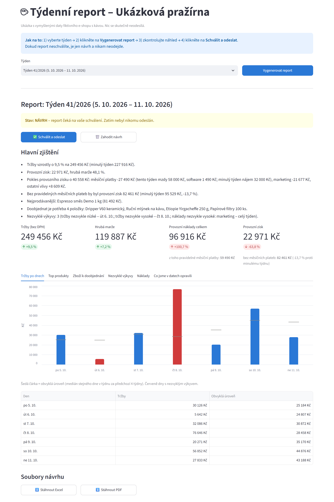

# Týdenní report pro malou firmu – ukázka automatizace

*English version below.*

**Co to řeší:** malá firma má čísla roztroušená v exportu z e-shopu, ručně vedené tabulce nákladů a skladovém
souboru. Každý týden je někdo ručně slepuje dohromady. Tahle ukázka to udělá jedním kliknutím: data sama
vyčistí, spočítá přehled (tržby, náklady, marže, co dochází na skladě, co bylo neobvyklé) a připraví Excel a PDF.
Report ale **neodejde, dokud ho člověk nezkontroluje a neschválí.**

Případová studie: [docs/pripadova-studie.md](docs/pripadova-studie.md).



> Všechna data jsou **vymyšlená** (fiktivní e-shop s kávou „Ukázková pražírna“). Nic se skutečně neodesílá.

## Co ukázka umí

| Krok | Co se děje |
|---|---|
| Načtení | Tři nesourodé zdroje: objednávky (CSV se středníky a desetinnou čárkou), náklady (Excel s nadpisem, prázdnými řádky a mezisoučty), sklad (CSV s čárkami). |
| Čištění | Sjednotí formáty dat (`3.8.2026`, `2026-08-05`, `05/08/2026`, buňky Excelu…), částky (`1 250 Kč`, `1250,50`), opraví překlepy v kategoriích (`Marketng` → Marketing, `Poštovné` → Doprava) a v kódech zboží (`KAV-ETI-25O` → `KAV-ETI-250`), vyřadí duplicity, prázdné řádky a mezisoučty. |
| Log změn | Každá úprava je zapsaná: zdroj, číslo řádku v původním souboru, původní a nová hodnota, důvod. Je vidět v panelu i v Excelu. |
| Report | Tržby, nákupní cena zboží, hrubá marže, provozní náklady (zvlášť pravidelné měsíční platby – mzdy, nájem, energie, software) a zisk i zisk bez měsíčních plateb (proti minulému týdnu), rozklad změny zisku (kolik udělaly měsíční platby, marketing a ostatní), top 5 produktů, zboží k doobjednání (s doporučeným množstvím), nezvyklé výkyvy tržeb a nákladů a pár vět „hlavních zjištění“. |
| Schválení | Report se uloží jako **návrh**. Teprve tlačítko **Schválit a odeslat** ho „odešle“ – v ukázce se jen zkopíruje do složky `odeslano/` spolu s textem zprávy a záznamem do deníku. Návrh jde i zahodit. Odeslat lze jen jednou. |
| Export | Excel (10 listů, česká čísla a měna) a PDF (A4, graf tržeb po dnech, tabulky). |
| Testy | 47 testů (pytest) pro čištění, výpočty, schvalování a exporty. |

- **Co se prodává nejvíc a nejméně:** nejprodávanější a pomalu se točící zboží, na kolik týdnů vydrží zásoba, prostor pro slevu a doporučení (zvaž slevu, vyřazení nebo balíček) – rozhoduje majitel; v panelu i orientační kalkulačka slevy (umí započítat dopravu, reklamu, provize, vratky a DPH a ukáže hranici nulového zisku i maximální slevu pro zvolenou cílovou marži).

## Jak spustit (Windows)

Potřebujete **Python 3.12 nebo novější** (vyzkoušeno na 3.14). Příkazy níže používají 3.14; s jinou verzí napište např. `py -3.12`.

```
py -3.14 -m venv .venv
.venv\Scripts\activate
pip install -r requirements.txt
streamlit run app.py
```

Příště už stačí **dvojklik na `spustit_panel.bat`** – panel se sám otevře v prohlížeči na adrese
http://localhost:8501. (Po spuštění přes `streamlit run app.py` otevřete adresu, kterou příkaz vypíše.)
Postup v panelu: vyberte týden → **Vygenerovat report** → zkontrolujte náhled → **Schválit a odeslat**.

Další příkazy:

```
python -m pytest                     # testy
python -m report_demo.generator      # znovu vygeneruje syntetická data do data/vstupy/
```

Na macOS/Linuxu místo `py -3.14` použijte `python3` a místo `.venv\Scripts\activate` `source .venv/bin/activate`.

## Co je syntetické

- Firma, produkty, ceny, objednávky, náklady i skladové zásoby jsou vymyšlené a vygenerované
  skriptem [`report_demo/generator.py`](report_demo/generator.py) s pevným seedem (pokaždé stejný výsledek).
- „Nepořádek“ v datech je vložený záměrně, aby bylo co čistit.
- Do posledního týdne (41/2026) jsou záměrně vložené tři události, které má report najít: den s výpadkem
  e-shopu, velká firemní objednávka a drahá marketingová kampaň. Zároveň jsou tři položky pod minimální
  zásobou a jedna má v souboru chybný záporný stav.
- Objednávky neobsahují žádné údaje o zákaznících.

## Co ukázka neumí (a reálné nasazení by muselo řešit)

- **Skutečné odesílání** – v ukázce se soubory jen zkopírují do složky.
- **Přihlášení a role** – kdo smí schvalovat, není řešeno; panel je určen pro jeden počítač.
- **DPH, slevy, vratky, doprava účtovaná zákazníkovi** – v reportu se vše bere jako bez DPH a vratky se neřeší; kalkulačka slevy je umí zahrnout jen orientačně a nepočítá s fixními náklady.
- **Historie skladu** – sklad je jeden snímek (poslední export); u starších týdnů se tedy nepočítá stav k tehdejšímu dni.
- **Výkyvy** jsou jednoduchá pravidla (např. tržba dne alespoň dvojnásobná nebo pod 40 % proti mediánu stejného dne
  v týdnu za 4 týdny). Nejde o statistický model; prahy je potřeba doladit na datech konkrétní firmy.
- **Oprava překlepů** podle podobnosti textu se může u velmi podobných kódů splést. Proto je každá oprava v logu.
- Data `05/08/2026` se čtou česky (den/měsíc). Americký zápis by se přečetl špatně.
- Naplánované spouštění (např. každé pondělí ráno) není součástí ukázky.

## Jak by se to napojilo na reálná data klienta

1. **Vstupy:** místo vygenerovaných souborů se načtou skutečné exporty – z e-shopu (CSV/XML export nebo přímé
   napojení na jeho rozhraní), tabulka nákladů ze sdíleného disku nebo OneDrive a skladový export. Upravuje se jen
   [`report_demo/nacitani.py`](report_demo/nacitani.py) a mapování názvů sloupců; čištění a výpočty zůstávají.
2. **Číselníky:** kategorie nákladů a jejich běžné „přezdívky“ se doplní podle toho, jak je firma skutečně píše.
3. **Kontrola s klientem:** první týdny běží report souběžně s ručním postupem a čísla se porovnají.
4. **Odeslání:** po schválení se zpráva s přílohami odešle přes firemní poštu (např. Microsoft 365 nebo SMTP)
   na předem dané příjemce.
5. **Provoz:** spouštění plánovačem (např. každé pondělí v 7:00 se připraví návrh), panel na počítači v kanceláři
   nebo na malém serveru. Data zůstávají u klienta.

## Struktura

```
app.py                      ovládací panel (Streamlit)
spustit_panel.bat           spuštění panelu dvojklikem (Windows)
report_demo/generator.py    generátor syntetických dat
report_demo/nacitani.py     načtení tří zdrojů
report_demo/cisteni.py      čištění a log změn
report_demo/report.py       výpočty týdenního reportu
report_demo/export.py       export do Excelu a PDF
report_demo/schvaleni.py    návrh → schválení → (simulované) odeslání
data/vstupy/                syntetická vstupní data
tests/                      testy (pytest)
docs/                       screenshot panelu, text nabídky
```

---

Vytvořeno s pomocí AI (Claude Code). Zadání, návrh, kontrola a testování: Jaroslav Kučera.

License: MIT (see [LICENSE](LICENSE))

---

# Weekly report for a small business – automation demo

**What it solves:** a small business keeps its numbers in an e-shop export, a hand-kept cost spreadsheet and a
stock file, and someone stitches them together by hand every week. This demo does it in one click: it cleans
the data, builds an overview (revenue, costs, margin, low stock, unusual swings) and prepares Excel and PDF
files. The report is **not sent until a person has reviewed and approved it.**

Case study (in Czech): [docs/pripadova-studie.md](docs/pripadova-studie.md).


> All data is **made up** (a fictional coffee e-shop). Nothing is actually sent.

## Features

- **Three inconsistent sources:** orders (semicolon CSV, decimal comma), costs (Excel with a title row, blank
  rows and subtotals), stock (comma CSV).
- **Cleaning:** unifies date and amount formats, fixes typos in categories and product codes, removes duplicates,
  blank rows and subtotal rows.
- **Change log:** every change is recorded with source, original row number, old and new value and reason.
- **Weekly report:** revenue, cost of goods, gross margin, operating costs (with regular monthly payments – wages, rent, energy, software – shown separately), profit and profit without monthly payments vs. the previous week, a breakdown of the profit change (monthly payments, marketing, other),
  top 5 products, items to reorder, unusual swings in revenue and costs, plus a few plain-language findings.
- **Approval step:** the report is saved as a **draft**; only **Approve and send** "sends" it (in the demo:
  copies files to `odeslano/` with the message text and a log entry). A draft can be discarded; it can be sent
  only once.
- **Exports:** Excel (10 sheets, Czech number formats) and PDF (A4, daily revenue chart, tables).
- **Tests:** 47 pytest tests for cleaning, calculations, approval and exports.
- **Best and slow sellers:** best-selling and slow-moving products, how many weeks the stock will last, discount headroom and rule-based suggestions without numbers (consider a discount, removal or a bundle) – the owner decides; the panel also has an indicative discount calculator (it can include shipping, advertising, commissions, returns and VAT, and shows the break-even discount and the maximum discount for a chosen target margin).

The user interface and outputs are in Czech, because the target customer is a Czech small business.

## How to run (Windows)

Requires **Python 3.12 or newer** (tested on 3.14). The commands below use 3.14; for another version use e.g. `py -3.12`.

```
py -3.14 -m venv .venv
.venv\Scripts\activate
pip install -r requirements.txt
streamlit run app.py
```

After the first setup, just **double-click `spustit_panel.bat`** – the panel opens in the browser at
http://localhost:8501. Tests: `python -m pytest`. Regenerate the synthetic data: `python -m report_demo.generator`.

## What is synthetic

Everything: company, products, prices, orders, costs and stock are generated by
[`report_demo/generator.py`](report_demo/generator.py) with a fixed seed. The mess in the data is deliberate.
The last week contains three planted events the report should find (an e-shop outage day, a large business
order, an expensive ad campaign). Orders contain no customer data.

## Limitations

No real sending, no user login or roles, no VAT/discount/returns handling in the report itself (the discount
calculator covers them only indicatively, without fixed costs), a single stock snapshot,
simple threshold rules for unusual swings (to be tuned on real data), similarity-based typo fixing can
be wrong for very similar codes (hence the log), dates like `05/08/2026` are read day-first, no scheduling.

## Connecting to a client's real data

Replace the loaders in [`report_demo/nacitani.py`](report_demo/nacitani.py) with the client's real exports
(e-shop export or direct connection, cost spreadsheet on a shared drive, stock export), extend the category
mapping, run in parallel with the manual process for a few weeks, send approved reports through the company's
messaging system (e.g. Microsoft 365), and schedule the draft generation. The data stays with the client.

---

Built with AI assistance (Claude Code). Specification, design, review and testing: Jaroslav Kučera.

License: MIT (see [LICENSE](LICENSE))
